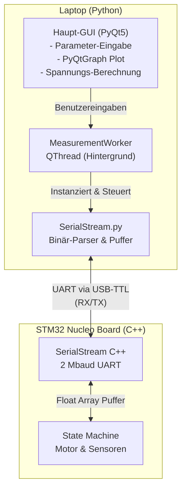
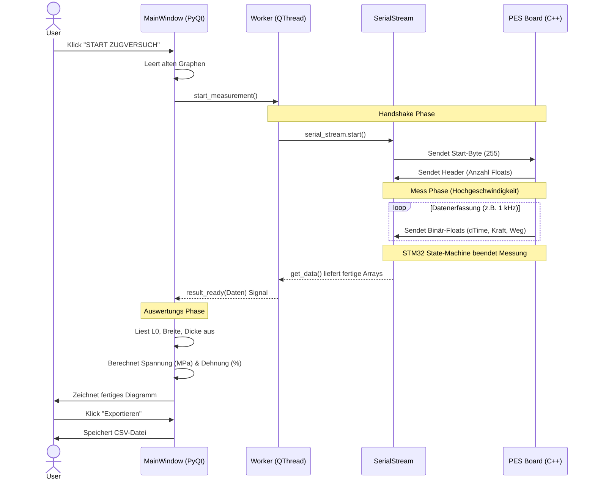

# Software Architektur: Zugprüfmaschine (PES Board)

Dieses Dokument visualisiert den Aufbau und den Datenfluss der Python-basierten Steuerungs- und Auswertungssoftware.
## 1. System-Architektur
Dieses Diagramm zeigt die physische und logische Trennung zwischen Laptop und STM32.

## 2. Datenfluss & Ablauf (Sequenz-Diagramm)

Dieses Diagramm zeigt den genauen zeitlichen Ablauf, wenn der Benutzer einen Zugversuch startet. Es visualisiert das "Handshake"-Protokoll mit dem Start-Byte und die asynchrone Datenverarbeitung.

## 3. Zuständigkeiten der Schichten

*   **STM32 (C++):** Reine Echtzeit-Datenerfassung und Motorsteuerung. Berechnet keine Spannungen, sondern liefert nur Rohwerte (`Delta-Zeit`, `Kraft in N`, `Weg in mm`).
*   **SerialStream (Python):** Übersetzer. Nimmt den kontinuierlichen 2 Mbaud Datenstrom auf und gießt ihn in strukturierte Numpy-Matrizen.
*   **MeasurementWorker (Python):** Der Dirigent. Hält die Verbindung offen, wartet auf das Ende der Messung und schützt die GUI vor Abstürzen.
*   **MainWindow (Python):** Die Präsentation und Logik. Übernimmt die gesamte Mathematik (Geometrie zu Spannung/Dehnung) und das Zeichnen der Graphen.